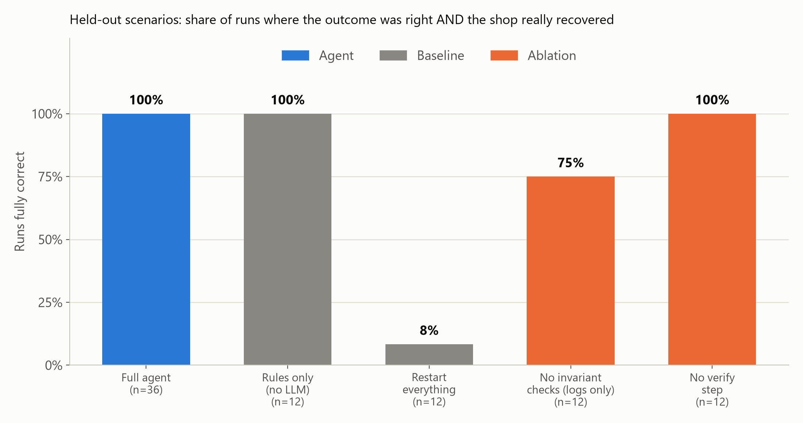
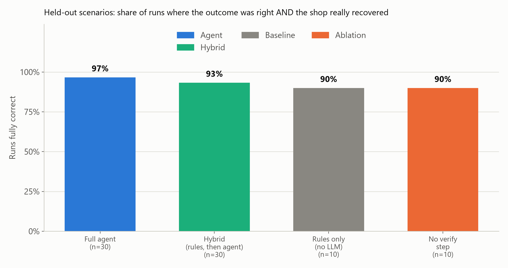
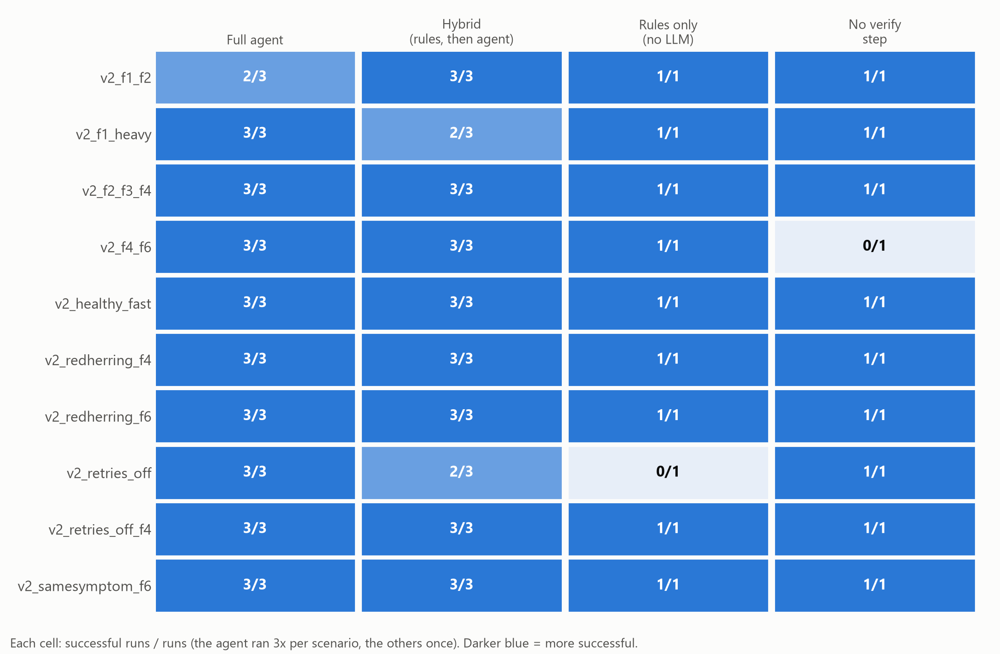

# Vitals: an AI on-call engineer that checks whether the system is doing its job

*HUMAIN "Future AI Builders" hackathon, Challenge 1: Agentic Recovery of a Failing System. Solo entry.*

## 1. What it is

Most monitoring and most "AI ops" demos read **error logs**. But the nastiest production failures are **silent**:
nothing crashes, no error is logged, `/health` says "ok", and the business quietly breaks. A payment is
acknowledged but the order is never saved. A queue drops messages under load. A sync job slowly corrupts rows.

**Vitals** takes a different angle. It checks the system's **business vital signs** (does every paid request become
an order? is every queued order accounted for? does the replica match what was copied?), then:

> **investigate -> diagnose -> act -> verify -> escalate to a human when it cannot fix something safely**

It runs against a small simulated e-commerce backend where we inject faults, and it is measured on held-out scenarios
it was never tuned on. Every run writes a markdown **incident report** (symptoms, evidence, root cause, actions,
verification).

**Short version of the results** (details and caveats in section 6):
- On our held-out scenarios the AI recovers the shop and says the right thing (fixed / nothing wrong / escalate) in
  **36/36** (round 1) and **29/30** (round 2) runs, with **no unnecessary actions** in most runs. Round 1 exposed a bug
  that left 1 to 4 orders lost in 5 of 36 runs; after the fix, **0 orders were lost in all 56 round-2 runs where the cause was fixable**.
- **Fixed if-then rules alone score almost the same** (12/12 and 9/10). The one place the AI clearly beat them is a bad
  setting no rule mentions. We say this plainly because it is the honest reading of the data.
- A **hybrid** (cheap rules first, AI only when the rules do not clearly apply) costs 21 to 54 percent fewer tokens
  with similar accuracy.
- A naive "restart everything" script fixes 1 of 12 held-out scenarios, claims success in 58 percent of runs where the
  shop was still broken, loses about 38 orders per run and caused duplicate shipments.

## 2. How it works: the hybrid flow

```
 customers --> SHOP: checkout + payments, order queue + worker, inventory sync (FastAPI + SQLite)
                 |  exposes: /metrics, /health, JSON logs, a read-only config view, 6 admin actions
                 v
 VITAL SIGNS: 8 business invariants, plain Python (no AI)
     | all pass ------------------------------------------> "no incident" (stop)
     v something fails
 RULE CHECK: which of the existing fixed rules match what is failing?
     | exactly one rule  --> run it --> re-check the vital signs --> pass --> done (no AI call, no tokens)
     |                                                          \--> still failing --+
     | no rule matches, or several conflict -----------------------------------------+
     v                                                                               v
                                    THE AI TAKES OVER (Claude Haiku 5.5, tool use)
        briefing (vital signs, metrics, config diff, recent logs) -> read-only investigation
        -> act (smallest safe action, with a reason and a confidence >= 0.5)
        -> VERIFY: wait 5 s, re-check the vital signs
        -> resolve (only if every vital sign passes) | escalate to a human with next steps
                                      |
                                      v
                       incident report in reports/*.md
```

The **vital signs** (`agent/invariants.py`): requests vs saved orders (exact, zero tolerance), queue accounting
(enqueued = processed + pending + in progress + parked + dead-letter), oldest in-progress order vs an SLA, worker
heartbeat, no parked orders, no dead letters, replica checksum equals what the last sync copied, and a payment
success rate (only if high over both 30 s and 5 s, so a correct fix clears it quickly).

The **rules** (`eval/methods.py`) are a fixed if-then table over those same vital signs. The **hybrid**
(`eval/hybrid.py`) only decides who acts, using the rules and the agent unchanged.

## 3. Architecture

```
recovery-agent/
|-- shop/        the "patient": checkout, fake payment provider, order queue + worker,
|                inventory sync, traffic generator, admin endpoints   (FastAPI + SQLite)
|-- chaos/       fault injector: turn faults F1..F8 on and off, several at once
|-- agent/       the AI on-call engineer: invariants, tools, loop, incident reports
|-- eval/        scenarios, harness, baselines, hybrid, scoring, report + charts
|-- demo/        demo mode for screen recording, and its script (demo/DEMO.md)
|-- tests/       50 tests (invariants, scoring, parsing, hybrid matching, demo text, healthy shop)
|-- scripts/     licence checker
|-- reports/     incident reports (generated, git-ignored)
|-- experiments.md   every change with its score before and after
```

Everything runs as plain Python processes on Windows (no Docker). The agent can only use the shop's HTTP
endpoints and its log files; it never reads or changes `chaos/` or the fault configuration (see section 8).

## 4. How the synthetic data and the faults are generated

**Traffic.** `shop/traffic.py` is a seeded generator: random orders (20 SKUs, quantity 1 to 3, amount 5 to 200),
random exponential gaps between orders, at a chosen rate. The same seed gives the same orders. The shop writes JSON
logs (`logs/*.jsonl`) and keeps orders, inventory and fulfilment steps in SQLite; each shop start begins clean.

**Faults.** `python -m chaos on fN` switches a fault on **while the shop is running**. A fault has up to two
parts: an *environment condition* (flaky provider, slow worker) written to `chaos/runtime_config.json`, and a
*bad deploy* written into the shop's **own** config while its last-known-good copy stays untouched, so the agent can roll back.

| Fault | In one line |
|---|---|
| **F1** payment drop | The provider times out and a bad `assume success` setting makes the shop confirm orders it never saved. |
| **F2** queue loss | A tiny queue with a silent `drop` policy throws away orders under load while counting them as queued. |
| **F3** sync corruption | A bad `fast` sync mode silently writes a few wrong rows to the replica on every run. |
| **F4** workflow hang | A worker's "pack" step never returns, so every order behind it waits; a restart clears it. |
| **F5** provider down | The payment provider is fully down; nothing the shop is allowed to do can fix it, so the right answer is to escalate. |
| **F6** silent save failure | The shop says "order confirmed" but quietly fails to write some orders; no config change, and no allowed action can fix the cause. |
| **F7** retries off | A deployed setting turns off payment retries while the provider is flaky; no rule mentions that setting, but a rollback fixes it. |
| **F8** red herring | A harmless cosmetic config change that breaks nothing but makes the config look different from last-known-good. |

Faults can be combined (F1+F4, F2+F3, F1+F2+F4, F4+F5, ...), given different rates, timings and seeds.

## 5. How to run each part

Python 3.14 on Windows, PowerShell. From the project folder:

```powershell
python -m venv ..\.venv ; ..\.venv\Scripts\Activate.ps1
pip install -r requirements.txt
copy .env.example .env          # then put your key in ANTHROPIC_API_KEY=
```

| What | Command |
|---|---|
| Start the shop | `python -m uvicorn shop.app:app --port 8000` |
| Send customer traffic | `python -m shop.traffic --rate 5 --duration 0 --seed 7` |
| Look at it | `curl http://127.0.0.1:8000/metrics` and `/health` |
| Inject / list / clear faults | `python -m chaos on f7 --rate 0.5`, `python -m chaos list`, `python -m chaos clear` |
| Run the AI agent once | `python -m agent.run` |
| **Demo mode (hybrid, step by step)** | `python -m demo --method hybrid --pause 0.6` (also `--method rules_only` or `agent`) |
| Demo script for the recording | `demo/DEMO.md` (F7: rules miss it, the AI fixes it; F5: escalation) |
| Unit tests (no API key) | `python -m pytest -m "not llm"` |
| All tests (adds one AI test, a few cents) | `python -m pytest` |
| Run the evaluation | `python -m eval.run --tag v2 --set heldout_v2 --methods agent hybrid --reps 3` |
| Build tables and charts | `python -m eval.report --tag v2 --holdout heldout_v2` |
| Check third-party licences | `python scripts/check_licenses.py` |

Eval options: `--set dev | heldout | heldout_v2`, `--methods agent hybrid rules_only restart_all no_invariants no_verify`.
Each job runs in its own isolated shop (its own port, logs, database) and finished jobs are skipped on a re-run.
The model defaults to `claude-haiku-5-5`; set `AGENT_MODEL` to change it.

## 6. Results

Method names: **agent** = AI with vital signs and a verify step; **hybrid** = rules first, then the AI;
**rules only** = fixed if-then rules, no AI; **restart everything** = naive script; **no invariants** = AI sees logs only;
**no verify** = AI without the post-action re-check. "Success" means the outcome was right **and** an independent check
confirms the shop really recovered (the harness checks, not the agent). All dollar figures use Haiku 5.5 list prices.

### Round 1: the original suite (held-out v1: 12 unseen scenarios, never tuned on)

| Method | Runs | Success | Orders lost / run | False "fixed" claims |
|---|---|---|---|---|
| **agent** | 36 | **36/36** | 0.28 | 0% |
| rules only | 12 | 12/12 | 0.08 | 0% |
| no verify | 12 | 12/12 | 0.17 | 0% |
| no invariant checks | 12 | 9/12 | 3.3 | 17% |
| restart everything | 12 | 1/12 | 38 | 58% |

The dev set (8 scenarios x 3, used while building) scored 24/24. Round 1 also found a real defect: in 5 of 36 agent
runs, 1 to 4 orders stayed lost after a "successful" fix (the replay gave up silently and a 5-request tolerance in a check hid the gap).



### Round 2: fixes, a new harder held-out set (v2), and the hybrid

We fixed that defect (exact zero-tolerance gap check, replay that retries until done or reports `unrecoverable`),
then wrote **10 new scenarios aimed at what fixed rules cannot anticipate**: a harmless config change next to a real
non-config fault, the same symptom with a different cause, a bad setting no rule mentions, a novel fault with no matching
action (correct answer: escalate), a fixable plus an unfixable fault, and repeats of old faults with new parameters.
They were committed **before** any run, and the agent, rules and hybrid were frozen first.

| Method | Runs | Success | Unnecessary actions / run | Tokens / run | Cost |
|---|---|---|---|---|---|
| **agent** | 30 | **29/30** | 0.23 | 36.3k | $0.095 |
| **hybrid** | 30 | 28/30 | 0.53 | 28.8k | $0.078 (handed to the AI in 67% of runs) |
| rules only | 10 | 9/10 | 0.60 | 0 | $0 |
| no verify | 10 | 9/10 | 0.20 | 38.1k | $0.032 |

On the round-1 held-out set re-run with the fixed shop, the hybrid scored 12/12 and cost $0.010 for 12 runs.
The fixed agent scored 24/24 on the dev set again after the changes ($0.036), and the hybrid scored 24/24 ($0.017).




### What the results do and do not show

- **The lost-orders fix held:** 0 orders lost in all 56 v2 runs where the cause was fixable (agent, hybrid, rules, no-verify).
- **Rules still nearly match the AI.** Every fault leaves a clear signature in the vital signs, so one rule per sign is
  enough for most scenarios. The only rules failure was the designed one: a bad config key no rule mentions
  (rules reported "no incident" while payments were failing; agent 3/3, hybrid 2/3, rules 0/1).
- **The AI did not out-reason the rules on the red herring:** it rolled back the harmless config change in 3/3 runs, exactly like the rules.
- **Novel faults were mislabelled:** for the unfixable "silent save failure" the agent escalated correctly every time but
  named the closest known cause (`payment_drop`) in 9/9 runs and "unknown" in only one of them. We therefore treat outcome and real recovery, not the label, as the primary measures.
- **The verify step mattered once:** without it, one run resolved when it should have escalated (n=1).
- **The hybrid saves money, not errors:** 21% fewer tokens on v2 (54% on the dev set), no accuracy gain.
- Full tables, every failed run, and the change log with before and after scores: `eval/results/v2/summary.md`, `eval/results/v1/summary.md`, `experiments.md`.

## 7. Why you can trust the evaluation

- **Held-out sets were committed to git before they were run** (`a2f0714` for v1, `b4c4651` for v2), and the agent was
  not tuned on them. Source hashes of the agent (`7dff666404`), rules (`9af179f477`) and hybrid (`0d189ae02a`) are
  stamped on every v2 result row (`eval/results/v2/frozen_hashes.txt`).
- **The harness judges the system independently.** After each run it checks the invariants itself, then audits the raw
  request log and the database for orders that were told "ok" but never saved, and for duplicate shipments.
  The agent's own claim of success is never taken at face value (we measure "false fixed claims").
- **Baselines and ablations** (restart-everything, rules-only, no invariant checks, no verify step) show what each part is worth.
- **Reproducible and isolated:** seeded traffic, each run in its own shop with its own state, one command per stage.
- **Honest scoring changes:** after round 1 we added a score that only expects root causes of faults that actually produced a symptom
  (the old score is kept, and round 1 was not re-scored).

## 8. Safety design

- **Action allowlist.** The agent can only call six admin actions (restart worker, requeue stuck, roll back config,
  replay lost orders, requeue unprocessed, resync replica). Anything else is refused.
- **No cheating.** The agent's tool module imports nothing from `shop/` or `chaos/`. It only sees metrics, health,
  an allow-listed set of log files, and a read-only config view. It cannot read or change the fault configuration.
- **Confidence threshold and retry budget.** An action needs a stated reason and confidence of at least 0.5. At most 6 actions and 14 model turns per run, then it escalates automatically instead of looping.
- **Verify before claiming victory.** After every action the harness waits 5 s and re-checks the vital signs. `resolve` is
  refused unless every vital sign passes; `no_incident` is refused if any action was taken.
- **Escalation with a report.** When the cause is outside the shop's control or no action helps, the agent must escalate with
  next steps for a human (an escalation without them is refused).
- **Safe, repeatable repairs.** Replay and requeue never create duplicates (verified: 0 duplicate shipments in all agent and
  hybrid runs); a second call finds nothing to do. The naive restart script, in contrast, caused duplicates.
- **Inspectable.** Every report lists the evidence, each action with its reason, the verification result, token use, and the raw tool calls the model sent.
- **Secrets.** `.env` is git-ignored; `.env.example` shows the format.

## 9. Limitations and honest notes

- **It is a simulation.** The shop, the faults and the "admin actions" are ours. The faults were designed by the same person who wrote the checks, and the rules were written knowing the fault design, so "held-out" means *not tuned on*, not *independent*.
- **Small samples.** The agent and hybrid ran 3 times per scenario; the baselines and ablations once (10 to 12 runs). Differences like 29/30 versus 28/30 versus 9/10 are within noise. 36/36 supports "about 90 percent or better", not 100 percent.
- **The AI's advantage is narrow here.** We showed it only for a bad setting no rule mentions. We did not show it beating well-written rules elsewhere, and it did not out-reason the rules on the red herring.
- **Root-cause labels are weak on novel faults** (a fixed list of categories has no right answer for them).
- **Round numbers are not directly comparable.** Round 1 ran on the older shop and checks; round 2 on the fixed ones. The scorer was extended after round 1.
- **Threshold noise.** Two v2 runs claimed "fixed" while the payment alarm fired again at the end; the honest failure rate in that scenario (about 17%) sits near the 25% threshold, so this is most likely noise (not verified).
- **One model, non-deterministic.** Everything used Claude Haiku 5.5; results vary a little run to run.
- **Timing is wall-clock.** Jobs ran three shops at once on one laptop; thresholds such as the 10 s SLA were chosen for that.
- **Total evaluation spend was about $0.43** (about $0.16 in round 1, $0.27 in round 2).

## 10. Third-party components and licences

Checked from the installed packages' metadata with `python scripts/check_licenses.py` (44 packages in the dependency closure; none is GPL, LGPL or AGPL in the way we use it).

| Component | Version | Licence | Used for |
|---|---|---|---|
| FastAPI | 0.162.0 | MIT | the shop's web API |
| Uvicorn | 0.54.0 | BSD-3-Clause | web server |
| Pydantic | 2.14.1 | MIT | request validation |
| Requests | 2.34.2 | Apache-2.0 | HTTP client (agent, traffic, eval) |
| Anthropic Python SDK | 2.3.0 | Apache-2.0 | the AI agent (Claude Haiku 5.5) |
| python-dotenv | 1.2.4 | BSD-3-Clause | reads `.env` |
| colorama | 0.4.6 | BSD-3-Clause | coloured demo output |
| pandas | 3.1.0 | BSD-3-Clause | eval summary tables |
| matplotlib | 3.11.2 | Matplotlib licence (PSF-based, BSD-compatible) | eval charts only (offline, not part of the running system) |
| pytest | 9.2.0 | MIT | tests |

Plus their transitive dependencies (all permissive: MIT, BSD, Apache-2.0, PSF, and similar; the full list prints from the script).

**One flag, explained.** The script flags matplotlib for a manual read: its wheel bundles the FreeType library, which is
**dual-licensed "FTL or GPL-2.0-or-later"**. We use it under the permissive **FreeType License (FTL)** option, and matplotlib is used only to draw charts offline, so
nothing GPL-licensed is part of the running system. If you want zero ambiguity, drop matplotlib and the three chart files; nothing else depends on it.

The AI model is accessed through Anthropic's API (commercial service, not a bundled component). The project has no licence file of its own yet.

Submitted to the HUMAIN Future AI Builders Hackathon; no open-source licence is granted.
